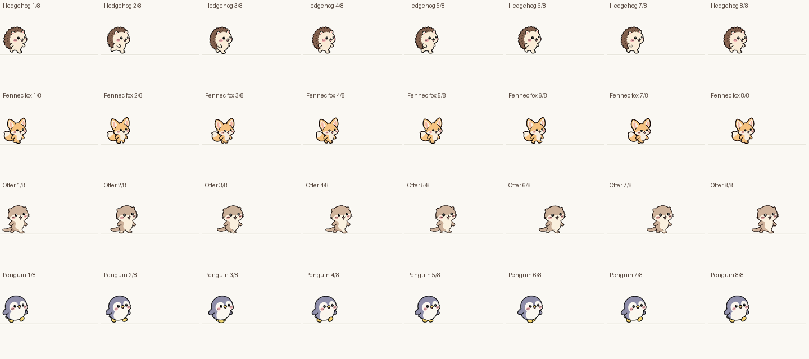

# v2 시스템 점검 · 2026-10-18

이동, 가구·장난감 이용, 들기와 낙하, 행동 전환, 해금, 저장·불러오기를 점검했다. 현재 그림과 발 접지 타이밍은 유지했다.

## 확인하고 수정한 문제

- **걸음 반복 시 시간 누락:** 여우 외 15종은 한 주기가 끝날 때 그 화면 프레임의 남은 시간을 버렸다. 모든 동물이 남은 시간까지 다음 주기로 이어가도록 수정했다. 동물별 접지·이동 곡선은 유지한다.
- **여우 마우스 따라오기 종료 누락:** 연속 걸음이 곧바로 다음 주기로 넘어가면서 종료 조건이 기다리는 ‘접지 상태’가 외부에 전달되지 않았다. 정해진 시간이 끝나면 다음 접지에서 종료하고, 예약된 달리기도 접지 후 시작한다.
- **벽 책장 독서 교감 누락:** 이용을 끝내도 독서 기록과 교감이 올라가지 않았다. 일반 책장과 같은 독서 기록에 연결했다.
- **벽난로 휴식 교감 누락:** 이용 완료를 휴식 기록에 연결했다. 기존 45초 중복 보상 제한은 유지한다.
- **손상된 저장 파일 복구 부재:** 정상 저장본을 `.bak`으로 보관하고, 기본 저장 파일을 읽지 못하면 정상 사본을 불러온다. 손상된 파일이 정상 사본을 덮어쓰지 않으며, 임시 파일의 쓰기 오류도 확인한다. 이 버전에서 정상 저장한 이후의 사본부터 복구할 수 있다.

## 검증

- 새 시스템 검사: **476개 통과**. 16종 × 새끼/성체 × 좌우 × 30/60/144fps의 192개 이동 조건, 긴 프레임 지연, 중단·방향 전환, 화면 경계, 따라오기 종료, 행동 예약, 가구 완료 보상, 인형 놀이 중단, 욕조 이용·제거, 저장 왕복·복구·쓰기 실패.
- 기존 기능 검사: 배치·이식 294개, 들기·착지·회복 1,729개, 생활·장난감 1,323개, 바닥·생쥐 1,938개, 일상 행동 5,154개, 욕조·도감·해금 2,575개 통과.
- 기존 여우·수달 접지 검사 1,342개 및 사막여우 검사 2,161개 통과.
- Windows 실제 렌더링 검사: **1,017개 통과**, 그중 고슴도치·여우·수달·펭귄 두 주기 이동의 **541프레임**을 저장했다. GIF는 같은 크기의 뷰포트에서 가져왔으며, 프레임별 재중앙 정렬이나 이동 보정은 하지 않았다.
- 실제 플레이 저장 파일은 검수 전후 SHA-256이 동일했다. 저장 오류 실험은 별도의 임시 파일에서만 수행했다.
- 4.37주기 이동 종료 지점의 최대 오차는 수정 전 3.3712픽셀, 수정 후 0.000012픽셀 미만이었다. 이는 이동 시뮬레이션 정확도 검사이며 그림의 자연스러움을 수치로 보증하는 값은 아니다.

## 검수 기준 정정

오래된 배치·상호작용·일상 행동 검사에는 현재 사양과 맞지 않는 예상값이 있었다. 예전 독서·음악 그림 이름, 이전 속도·토끼 크기, 낙하 중 들기 자세, 4배 연장 전의 행동 제한 시간을 현재 사양으로 갱신했다. 실제 동작 오류는 수정 전 같은 조건으로 재현하고 별도의 회귀 검사로 확인했다.

검수는 해당 실행본과 현재 Windows 환경을 기준으로 했다. 모든 그림 프레임의 해부학적 완성도, 모든 모니터·배율·그래픽 드라이버 조합이나 장시간 운용까지 보증하지 않는다.

[전체 검사 결과](summary.json) · [고슴도치](walk-3.gif) · [여우](walk-5.gif) · [수달](walk-1.gif) · [펭귄](walk-15.gif)

